# ambientCG: Paving Stones materials

**23 assets from [ambientCG](https://ambientcg.com), dedicated to the public domain under [CC0](https://docs.ambientcg.com/license/).** Use them in any game, free or paid, and change them however you like; no credit is needed.

PBR materials as 1K and 2K JPG maps (colour, normal GL and DX, roughness, AO, displacement), one folder per resolution. 862.0 MB in all.

This is a copy kept by [zuujis-cc0](https://github.com/zuujis-cc0) so game makers can take single files from GitHub. It is not made by or affiliated with ambientCG: the originals, often in more formats and higher resolutions, are on [ambientcg.com](https://ambientcg.com). If they help you, consider [supporting ambientCG](https://www.patreon.com/ambientCG).

Every file is listed in [MANIFEST.tsv](MANIFEST.tsv) with its size and SHA-256. More free assets: [the Zuujis collection](https://github.com/zuujis-cc0/free-game-assets#readme).

| | | | |
| :-: | :-: | :-: | :-: |
| <a href="PavingStones025">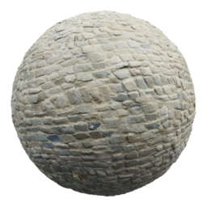</a> <b><a href="PavingStones025">Paving Stones 025</a></b> by ambientCG · <a href="https://ambientcg.com/a/PavingStones025">source</a> | <a href="PavingStones026">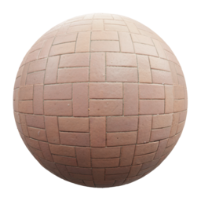</a> <b><a href="PavingStones026">Paving Stones 026</a></b> by ambientCG · <a href="https://ambientcg.com/a/PavingStones026">source</a> | <a href="PavingStones027">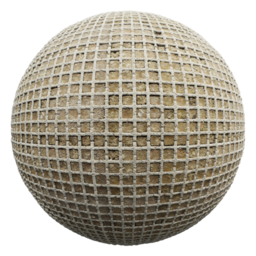</a> <b><a href="PavingStones027">Paving Stones 027</a></b> by ambientCG · <a href="https://ambientcg.com/a/PavingStones027">source</a> | <a href="PavingStones028">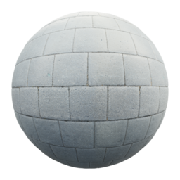</a> <b><a href="PavingStones028">Paving Stones 028</a></b> by ambientCG · <a href="https://ambientcg.com/a/PavingStones028">source</a> |
| <a href="PavingStones029">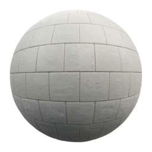</a> <b><a href="PavingStones029">Paving Stones 029</a></b> by ambientCG · <a href="https://ambientcg.com/a/PavingStones029">source</a> | <a href="PavingStones030">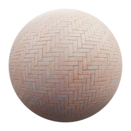</a> <b><a href="PavingStones030">Paving Stones 030</a></b> by ambientCG · <a href="https://ambientcg.com/a/PavingStones030">source</a> | <a href="PavingStones031">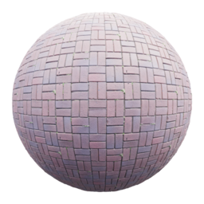</a> <b><a href="PavingStones031">Paving Stones 031</a></b> by ambientCG · <a href="https://ambientcg.com/a/PavingStones031">source</a> | <a href="PavingStones032">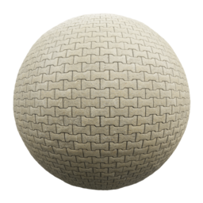</a> <b><a href="PavingStones032">Paving Stones 032</a></b> by ambientCG · <a href="https://ambientcg.com/a/PavingStones032">source</a> |
| <a href="PavingStones033">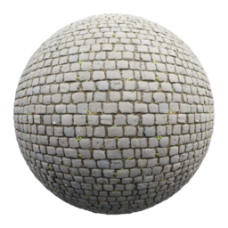</a> <b><a href="PavingStones033">Paving Stones 033</a></b> by ambientCG · <a href="https://ambientcg.com/a/PavingStones033">source</a> | <a href="PavingStones034">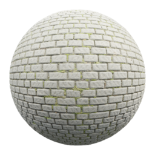</a> <b><a href="PavingStones034">Paving Stones 034</a></b> by ambientCG · <a href="https://ambientcg.com/a/PavingStones034">source</a> | <a href="PavingStones035">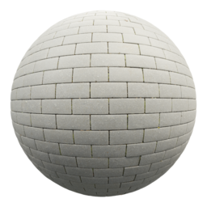</a> <b><a href="PavingStones035">Paving Stones 035</a></b> by ambientCG · <a href="https://ambientcg.com/a/PavingStones035">source</a> | <a href="PavingStones036">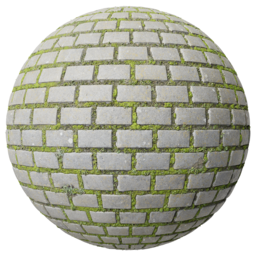</a> <b><a href="PavingStones036">Paving Stones 036</a></b> by ambientCG · <a href="https://ambientcg.com/a/PavingStones036">source</a> |
| <a href="PavingStones037">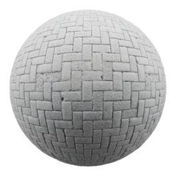</a> <b><a href="PavingStones037">Paving Stones 037</a></b> by ambientCG · <a href="https://ambientcg.com/a/PavingStones037">source</a> | <a href="PavingStones038">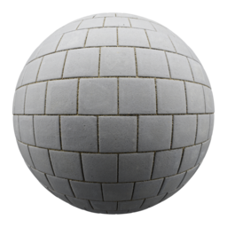</a> <b><a href="PavingStones038">Paving Stones 038</a></b> by ambientCG · <a href="https://ambientcg.com/a/PavingStones038">source</a> | <a href="PavingStones039">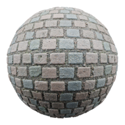</a> <b><a href="PavingStones039">Paving Stones 039</a></b> by ambientCG · <a href="https://ambientcg.com/a/PavingStones039">source</a> | <a href="PavingStones040">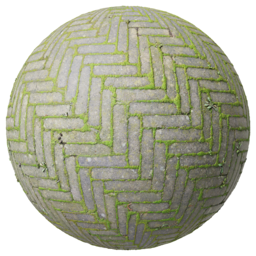</a> <b><a href="PavingStones040">Paving Stones 040</a></b> by ambientCG · <a href="https://ambientcg.com/a/PavingStones040">source</a> |
| <a href="PavingStones041">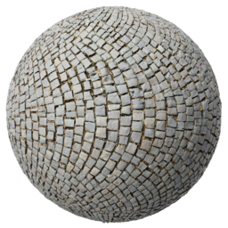</a> <b><a href="PavingStones041">Paving Stones 041</a></b> by ambientCG · <a href="https://ambientcg.com/a/PavingStones041">source</a> | <a href="PavingStones042">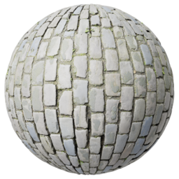</a> <b><a href="PavingStones042">Paving Stones 042</a></b> by ambientCG · <a href="https://ambientcg.com/a/PavingStones042">source</a> | <a href="PavingStones043">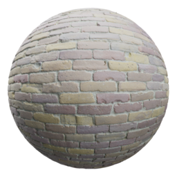</a> <b><a href="PavingStones043">Paving Stones 043</a></b> by ambientCG · <a href="https://ambientcg.com/a/PavingStones043">source</a> | <a href="PavingStones044">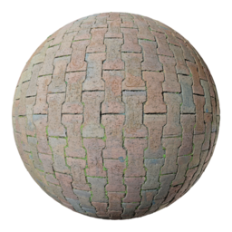</a> <b><a href="PavingStones044">Paving Stones 044</a></b> by ambientCG · <a href="https://ambientcg.com/a/PavingStones044">source</a> |
| <a href="PavingStones045">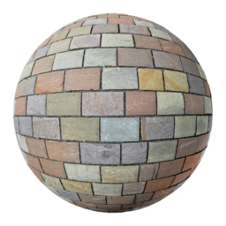</a> <b><a href="PavingStones045">Paving Stones 045</a></b> by ambientCG · <a href="https://ambientcg.com/a/PavingStones045">source</a> | <a href="PavingStones046">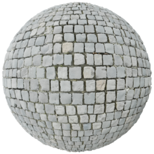</a> <b><a href="PavingStones046">Paving Stones 046</a></b> by ambientCG · <a href="https://ambientcg.com/a/PavingStones046">source</a> | <a href="PavingStones047">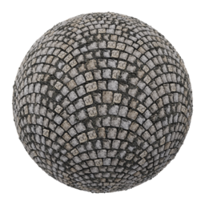</a> <b><a href="PavingStones047">Paving Stones 047</a></b> by ambientCG · <a href="https://ambientcg.com/a/PavingStones047">source</a> |  |

---

Kept up to date by this repository's own [update workflow](.github/workflows/update.yml), with code and plan from [cc0-mirror](https://github.com/zuujis-cc0/cc0-mirror). Something wrong? [Open an issue there](https://github.com/zuujis-cc0/cc0-mirror/issues/new) or use the [private report form](https://games.zuujis.com/report).
